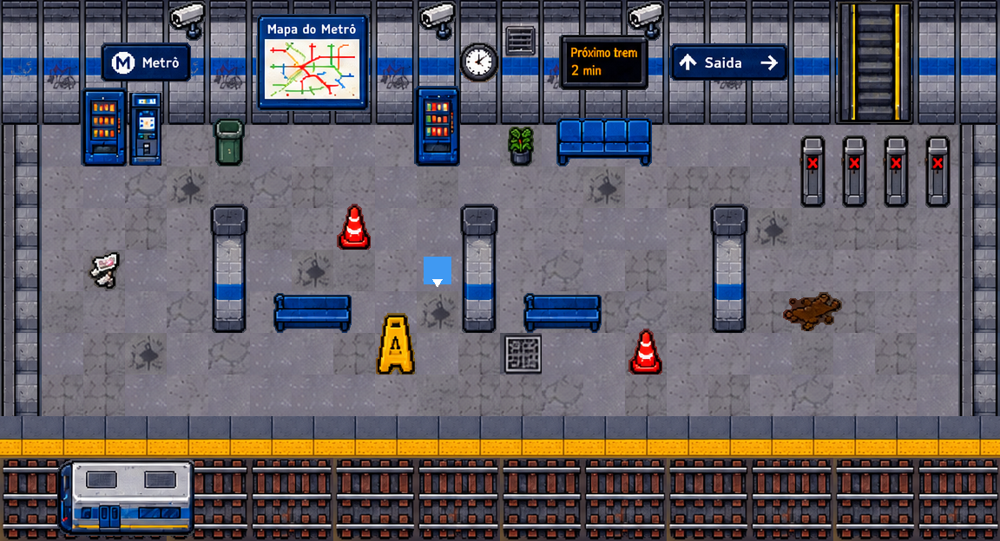

# projetoMetro (nome provisório)

Projeto do 2º bimestre — Jogos Digitais II (2026/2).

## A carta

| Parte da carta | Valor |
|---|---|
| Tema | Estação de metrô à meia-noite com passageiros fantasmas |
| Tipo de jogo | **Fuga** — sobreviver até a saída abrir (60 s) e alcançá-la |
| Modo | **Horda** (arena vista de cima) |

**Vence quando:** alcança a saída, que destranca depois de 60 segundos.
**Perde quando:** a vida acaba.

## Como jogar

- **WASD** ou **setas**: andar nas quatro direções.

A arena segue o `ideia_cenario.png`: parede no topo com placas (Metrô, Mapa, Próximo trem, Saída),
câmeras, relógio e a escada rolante (futura saída); plataforma com máquinas de venda, bilheteria, lixeira,
planta, bancos, pilares, cones, placa de piso molhado e catracas; faixa amarela e trilhos com um vagão.

Tudo é feito com TileMapLayer e um único TileSet (`sprites/metro_tileset.tres`). A colisão está no próprio
TileSet (Physics Layer `mundo`): paredes, trilhos e a base de cada objeto. A camada `Objetos` e o jogador
ficam dentro de `Mundo`, com Y-Sort, para o jogador passar "atrás" dos objetos altos.

## Captura de tela



## Estrutura

```
project.godot
scenes/    principal.tscn  (Chao, Detalhes = TileMapLayer; Mundo/Objetos + Jogador com Y-Sort)
entities/  jogador.tscn
scripts/   jogador.gd
sprites/   metro_tileset_48px.png (folha de tiles), metro_tileset.tres (TileSet com colisão), captura.png
```

## Créditos e origem do código

- Movimento com `Input.get_vector` + `move_and_slide`: baseado na documentação da Godot (CharacterBody2D).
- Código escrito com apoio de assistente de IA (Claude), revisado por mim.
- Folha de tiles `sprites/metro_tileset_48px.png`: autor _(preencher)_, link _(preencher)_, licença _(preencher)_.
